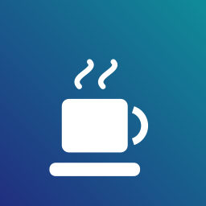

<div align="center">



# 清醒 Qingxing

**macOS 菜单栏防睡眠小工具**

**合盖不休眠 · 关屏不中断 · 按电源条件生效**

简体中文 ｜ [English](README.en.md)


-green)


</div>

---

## ✨ 功能特性

- 🌙 **合盖继续工作** —— 合上盖子（扣盖）Mac 照常运行，屏幕自动关闭，任务不断
- 🌑 **关屏继续工作** —— 盖子开着、屏幕熄灭，系统保持唤醒，下载 / 编译 / 跑任务不中断
- ☀️ **屏幕常亮** —— 屏幕和系统都不进入睡眠
- ⚡ **生效条件可选** —— **始终 / 仅插电源时 / 仅用电池时**，插拔电源自动切换（本项目与同类工具的核心差异）
- ⏻ **一键：立即关屏并继续工作**
- ↩️ **一键恢复 macOS 默认** —— 所有设置还原，正常睡眠回归
- 🇨🇳 纯中文界面 · 单文件 Swift · 无第三方依赖 · 不联网 · 不常驻后台守护进程

## 📦 安装

只需 Command Line Tools（`swiftc`），**无需 Xcode 工程**：

```zsh
git clone https://github.com/baiiiii521/Qingxing.git
cd Qingxing
./build.sh          # 产出 dist/Qingxing.app
open dist/Qingxing.app
```

建议把 `Qingxing.app` 拖到「应用程序」文件夹后再开启"登录时自动启动"。

首次运行有中文欢迎说明；切换"合盖继续工作"时会弹**一次**系统管理员密码框（原理见下）。

## 🚀 使用

点击菜单栏 🌙 / ☕ 图标：

| 菜单项 | 作用 |
|---|---|
| 🌙 合盖继续工作 | 扣盖不休眠，合盖后屏幕自动关闭、任务继续 |
| 🌑 关屏继续工作 | 盖子开着，屏幕可熄灭但系统不睡 |
| ☀️ 屏幕常亮 | 屏幕和系统都不睡 |
| ⏻ 一键：立即关屏并继续工作 | 自动打开"关屏继续工作"并立刻熄屏 |
| ⚡ 生效条件 | 始终 / 仅插电源时 / 仅用电池时 |
| ↩️ 恢复 macOS 默认 | 关闭全部模式并清除 pmset 设置 |
| 🚀 登录时自动启动 | 系统登录项（SMAppService） |

图标状态：🌙 = Mac 可正常睡眠；☕ = 有模式生效中。菜单顶部实时显示当前电源（交流 / 电池）与生效中的模式。

> 💡 **选哪个？** 挂机下载、人不在电脑前 → 只开"关屏继续工作"（免密码，退出即恢复）；要把 Mac 合盖当主机 / 装包里跑任务 → 开"合盖继续工作"（其本身就包含关屏继续工作的效果）。两者可同时开启，互不冲突。

## 🔧 工作原理

| 模式 | 实现 | 权限 | 生效方式 |
|---|---|---|---|
| 合盖继续工作 | `pmset disablesleep`（内核 SleepDisabled 标志，按 `-c` / `-b` / `-a` 分电源写入） | 需一次管理员授权 | 系统级、持久（重启仍生效） |
| 关屏继续工作 | IOKit 断言 `PreventUserIdleSystemSleep` | 无需权限 | App 退出自动失效 |
| 屏幕常亮 | IOKit 断言 `PreventUserIdleDisplaySleep` | 无需权限 | App 退出自动失效 |

`caffeinate` / IOKit 断言只能阻止"闲置休眠"，**挡不住合盖**——合盖走的是硬件触发的内核路径，修改 `SleepDisabled` 是目前唯一免内核扩展的可靠方案（Sleepless、Owly 等项目采用同一路线）。

"生效条件"：断言类模式由 IOPS 电源通知实时挂载 / 释放；合盖模式映射为 pmset 对应电源配置，开启时自动记录原闲置睡眠时长并临时设为 `sleep 0`（macOS 26/27 上电池场景需要），关闭时自动还原。

## 🆚 与现有工具对比

| | Qingxing | [Sleepless](https://github.com/Aboudjem/Sleepless) | [Owly](https://github.com/Aarontaken/owly) | [StayAwake](https://github.com/TY-teo/StayAwake) | [KeepingYouAwake](https://github.com/newmarcel/KeepingYouAwake) | [Amphetamine](https://apps.apple.com/app/amphetamine/id937984704) |
|---|---|---|---|---|---|---|
| 合盖不休眠 | ✅ | ✅ | ✅ | ✅ | ❌ | ❌ |
| 关屏继续工作（屏幕可熄） | ✅ | ✅ | ✅ | ✅ | ✅ | ✅ |
| **按电源条件生效（仅插电 / 仅电池）** | ✅ | ❌ | ❌ | ❌ | ❌ | ⚠️ 部分 |
| 中文界面 | ✅ | ❌ | ✅ | ✅ | ❌ | ❌ |
| 无需安装 sudoers / 守护进程 | ✅ | ❌ | ❌ | ❌ | ✅ | ✅ |
| 开源 | ✅ MIT | ✅ | ✅ | ✅ | ✅ | ❌ |

## ⚠️ macOS 26 / 27 注意事项

- 新系统 `pmset -g custom` 不再列出 `disablesleep`，判断状态需读 `pmset -g` 的 `SleepDisabled`（live 值），本项目已适配
- 多方报告：新系统**电池供电**时仅设 `disablesleep` 可能仍被睡眠策略覆盖，需配合 `sleep 0`，本项目开启合盖模式时自动处理；若个别机型电池合盖仍睡眠，插电使用最可靠（[Apple 社区讨论](https://discussions.apple.com/thread/256305994)）
- 合盖运行时散热变差、电池持续耗电，请自行权衡

## 🛠 构建与开发

```zsh
./build.sh                              # 编译 + 生成图标 + 打包 + ad-hoc 签名
swiftc test_core.swift -o t && ./t      # 核心逻辑自测（无需任何权限）
```

```
├── main.swift      # 全部代码：AppKit 菜单栏应用，单文件约 600 行
├── Info.plist      # LSUIElement=1，纯菜单栏应用，不占 Dock
├── gen_icon.swift  # 图标生成（CoreGraphics 画咖啡杯）
├── build.sh        # 一键构建
├── test_core.swift # 核心逻辑自测
└── docs/           # 文档资源
```

- 产物为 arm64（Apple Silicon）；需要 Intel 可在 `build.sh` 给 `swiftc` 加 `-arch x86_64`
- 查看运行状态：`pmset -g assertions`（断言）、`pmset -g | grep SleepDisabled`（合盖开关）

## 🧹 卸载与恢复

1. 菜单 → ↩️ 恢复 macOS 默认（或手动 `sudo pmset -a disablesleep 0`）
2. 退出 App（菜单 → 退出），删除 `Qingxing.app` 即可；断言类模式随进程退出自动失效

## ❓ FAQ

**为什么"合盖继续工作"要输管理员密码？**
它修改的是系统级电源管理设置（`pmset disablesleep`），与在终端执行 `sudo pmset ...` 是一回事，只在开关时弹一次。

**拔掉电源会发生什么？**
取决于你选的生效条件：断言类模式实时自动挂载 / 释放；合盖模式按 pmset 对应电源配置生效。

**App 退出了，设置还在吗？**
断言类模式立即失效（安全）；合盖模式是持久设置，重启也生效——用"恢复 macOS 默认"一键还原。

## 🙏 致谢

本项目站在前人验证过的技术路线上，感谢：[Sleepless](https://github.com/Aboudjem/Sleepless) · [Owly](https://github.com/Aarontaken/owly) · [StayAwake](https://github.com/TY-teo/StayAwake) · [KeepingYouAwake](https://github.com/newmarcel/KeepingYouAwake)

## 📄 License

[MIT](LICENSE) © 2026 baiiiii521
